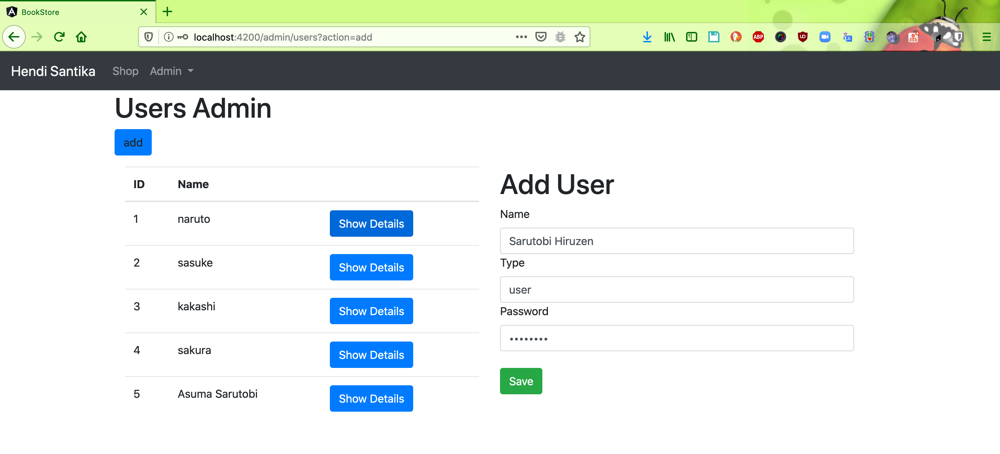
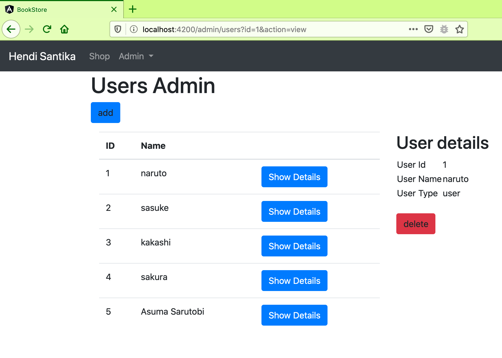
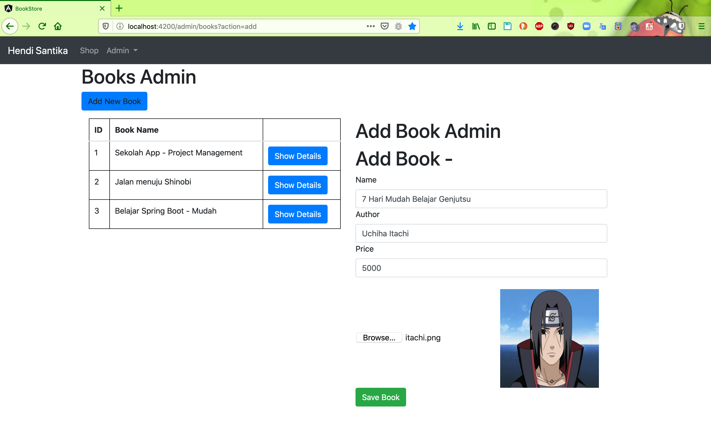
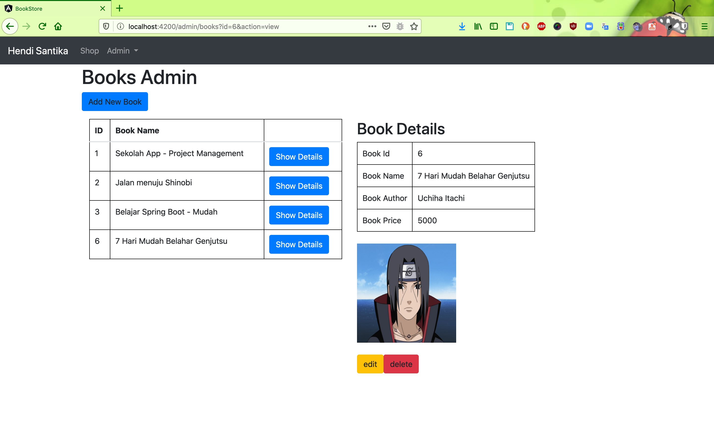
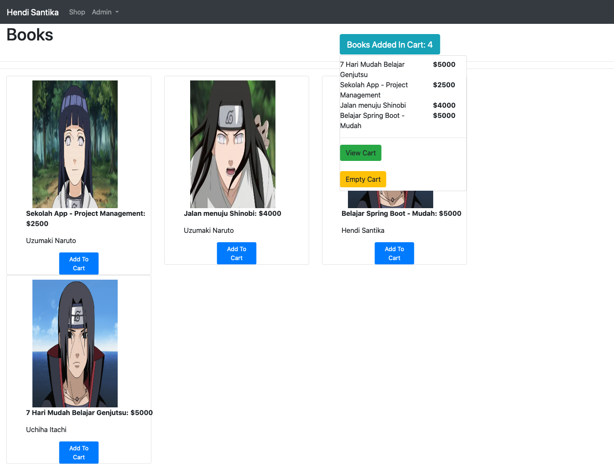

# online-book-store

Simple online book store: a Spring Boot REST backend (books & users, MySQL via Spring Data JPA) with an Angular frontend.

### Tech stack

| Layer    | Technology                                       |
|----------|--------------------------------------------------|
| Language | Java 25 (Gradle toolchain)                       |
| Backend  | Spring Boot 4.1.x — Web MVC, Data JPA, DevTools  |
| Database | MySQL 8+ (`mysql-connector-j`)                   |
| Build    | Gradle 9.8 (wrapper included)                    |
| Frontend | Angular (in `frontend/`)                         |

### Prerequisites

- JDK 25 (e.g. [Eclipse Temurin](https://adoptium.net/)) — Gradle toolchain is set to Java 25
- MySQL running on `localhost:3306` with user `root` / password `root`
  (the `online_book_store` database is created automatically — see `src/main/resources/application.properties`)
- Node.js & npm + Angular CLI for the frontend

### Things to do

1. Clone this repository: `git clone https://github.com/hendisantika/online-book-store.git`
2. Go inside the folder: `cd online-book-store`
3. Build & run tests: `./gradlew clean build`
4. Run the application: `./gradlew bootRun`
5. Open new terminal console then go inside frontend folder: `cd frontend`
6. Run `npm install`
7. Run `ng serve -o`

### CI/CD & dependency updates

- **GitHub Actions** (`.github/workflows/gradle.yml`): builds and tests the backend on JDK 25 (Temurin) for every push
  and pull request to `master`, and submits the Gradle dependency graph for Dependabot alerts.
- **Dependabot** (`.github/dependabot.yml`):
  - Gradle — daily, Spring Boot and minor/patch updates grouped
  - GitHub Actions — weekly, grouped
  - npm (`frontend/`) — weekly, Angular and minor/patch updates grouped

### Screen shot

Add New User

List Users

Shop Books

Add New Book

Book Details

Book Order

Book Cart

